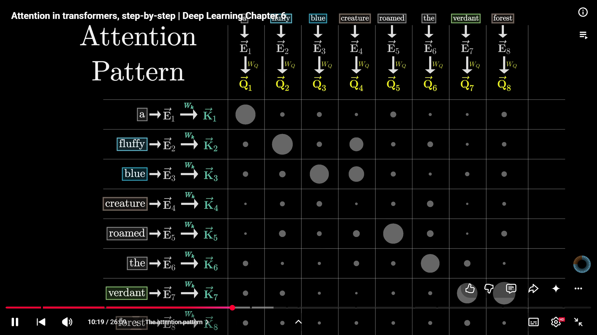

## Attentions

Transformers is an architectural design of a deep learning model which was used to translate language. It as first described by google team in the paper `Attention is all you Need` to be used in the models such as bert (recheck it). This architecutural design became more and more popular with the advent and huge popularity of generative models, because transformers allows the **parallel computation** which became very useful scaling of language models as they became more and more bigger.

The main layer of transformer architecture is attention layer which embed the meaning of word into its embedding based on the context window. It can be explained by following example:
- `Aman was sitting on the bank of gandhak river`
- `Aman went to bank to deposit his money`
In both of these sentences `bank` has different meaning which can only be infered from the context of sentence. Attention layer embed this meaning into the vector of the word. The attention mechanism works by the scaler multiplication of words with all the other words and

`Formulae`

This attention mechanism is also used for finding other similarities between different tokens.
- words to token of sound wave (for speech to text, and vice versa), 
- Tokens (pixel) to Tokens(words)  -- For word to image, or image to word
- Word to Word (different language) -- For translation
- Word to Word -- For text generation

Here the scaler multiplication of query (Q) and key (K) vectors are done to produce a new matrix which has information of relation between words embedded into the vectors.
The key here can be word of same language, pixel, or sound wave token. It is just used to find relation between the key and query pair using scaler multiplication.

### Masking : 
It is not necessarily used by all models but is important when doing tasks like text generation in GPT models where we do not want the future words to affect the past words.
It is done making the elements in the lower triangle of attention matrix into (-infinity) and then adding soft-max to normalize the values thus making the lower triangle elements into 0.

![[Pasted image 20260815163111.png|700]]

### One head attention
![[Pasted image 20260815163651.png|700]]

### Multi layer perceptron

![[Pasted image 20260819231520.png|700]]

## References
1. [3Blue1B -  Attention](https://www.youtube.com/watch?v=eMlx5fFNoYc&list=PLZHQObOWTQDNU6R1_67000Dx_ZCJB-3pi&index=7)
Resources to check
2. [Transformers](https://web.stanford.edu/class/psych209/Readings/SuttonBartoIPRLBook2ndEd.pdf)